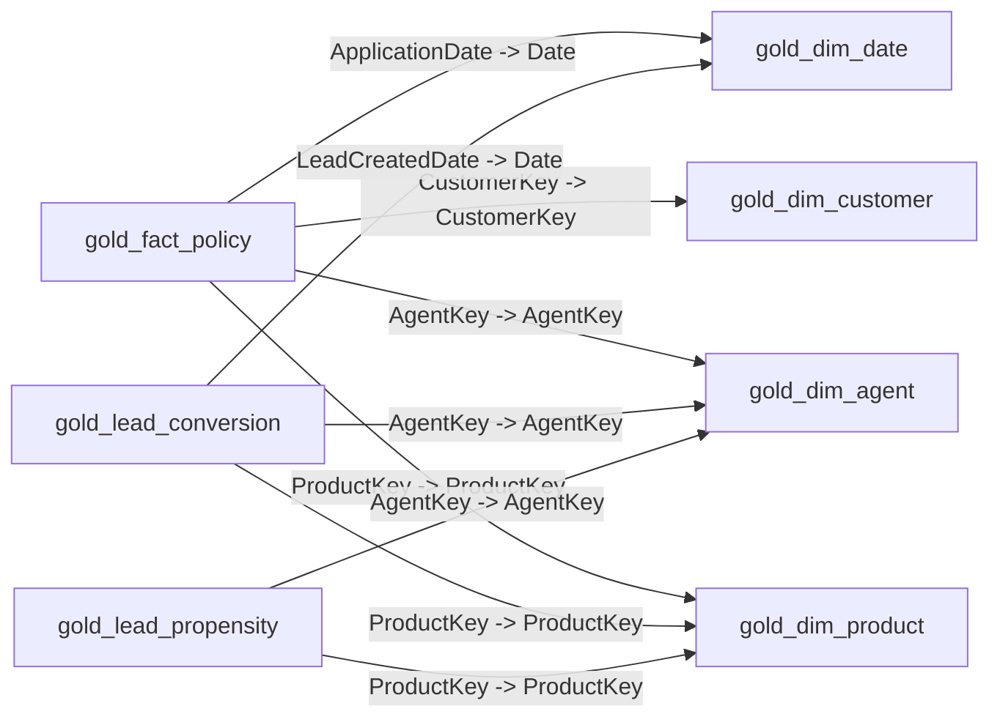

# Semantic Model Relationships

Relationships: **9**

## Relationship Flow



## Relationship Inventory

| From | To | Cardinality | Cross filter | Active |
|---|---|---|---|---|
| gold_fact_policy[ApplicationDate] | gold_dim_date[Date] | many (default) -> one (default) | oneDirection (default) | true (default) |
| gold_fact_policy[CustomerKey] | gold_dim_customer[CustomerKey] | many (default) -> one (default) | oneDirection (default) | true (default) |
| gold_fact_policy[AgentKey] | gold_dim_agent[AgentKey] | many (default) -> one (default) | oneDirection (default) | true (default) |
| gold_fact_policy[ProductKey] | gold_dim_product[ProductKey] | many (default) -> one (default) | oneDirection (default) | true (default) |
| gold_lead_conversion[LeadCreatedDate] | gold_dim_date[Date] | many (default) -> one (default) | oneDirection (default) | true (default) |
| gold_lead_conversion[ProductKey] | gold_dim_product[ProductKey] | many (default) -> one (default) | oneDirection (default) | true (default) |
| gold_lead_conversion[AgentKey] | gold_dim_agent[AgentKey] | many (default) -> one (default) | oneDirection (default) | true (default) |
| gold_lead_propensity[ProductKey] | gold_dim_product[ProductKey] | many (default) -> one (default) | oneDirection (default) | true (default) |
| gold_lead_propensity[AgentKey] | gold_dim_agent[AgentKey] | many (default) -> one (default) | oneDirection (default) | true (default) |

<details>
<summary><strong>gold_fact_policy[ApplicationDate] -> gold_dim_date[Date]</strong></summary>

```text
Relationship ID: d9944d74-a2c2-e795-fba9-bfaa74c8311a
From cardinality: many (default)
To cardinality: one (default)
Cross filtering: oneDirection (default)
Active: true (default)
Security filtering: 
Join on date behavior: 

Raw TMDL:
relationship d9944d74-a2c2-e795-fba9-bfaa74c8311a
	fromColumn: gold_fact_policy.ApplicationDate
	toColumn: gold_dim_date.Date
```

</details>

<details>
<summary><strong>gold_fact_policy[CustomerKey] -> gold_dim_customer[CustomerKey]</strong></summary>

```text
Relationship ID: 344ff002-9a20-104e-9a87-a0ae2591e725
From cardinality: many (default)
To cardinality: one (default)
Cross filtering: oneDirection (default)
Active: true (default)
Security filtering: 
Join on date behavior: 

Raw TMDL:
relationship 344ff002-9a20-104e-9a87-a0ae2591e725
	fromColumn: gold_fact_policy.CustomerKey
	toColumn: gold_dim_customer.CustomerKey
```

</details>

<details>
<summary><strong>gold_fact_policy[AgentKey] -> gold_dim_agent[AgentKey]</strong></summary>

```text
Relationship ID: 5c6aaf13-d398-3782-5208-2cf90f9ad7e0
From cardinality: many (default)
To cardinality: one (default)
Cross filtering: oneDirection (default)
Active: true (default)
Security filtering: 
Join on date behavior: 

Raw TMDL:
relationship 5c6aaf13-d398-3782-5208-2cf90f9ad7e0
	fromColumn: gold_fact_policy.AgentKey
	toColumn: gold_dim_agent.AgentKey
```

</details>

<details>
<summary><strong>gold_fact_policy[ProductKey] -> gold_dim_product[ProductKey]</strong></summary>

```text
Relationship ID: 1859fcd6-fc26-de6b-c587-3db9a86d40fa
From cardinality: many (default)
To cardinality: one (default)
Cross filtering: oneDirection (default)
Active: true (default)
Security filtering: 
Join on date behavior: 

Raw TMDL:
relationship 1859fcd6-fc26-de6b-c587-3db9a86d40fa
	fromColumn: gold_fact_policy.ProductKey
	toColumn: gold_dim_product.ProductKey
```

</details>

<details>
<summary><strong>gold_lead_conversion[LeadCreatedDate] -> gold_dim_date[Date]</strong></summary>

```text
Relationship ID: d9cb3f3f-0178-aa9f-c587-868ed477e49b
From cardinality: many (default)
To cardinality: one (default)
Cross filtering: oneDirection (default)
Active: true (default)
Security filtering: 
Join on date behavior: 

Raw TMDL:
relationship d9cb3f3f-0178-aa9f-c587-868ed477e49b
	fromColumn: gold_lead_conversion.LeadCreatedDate
	toColumn: gold_dim_date.Date
```

</details>

<details>
<summary><strong>gold_lead_conversion[ProductKey] -> gold_dim_product[ProductKey]</strong></summary>

```text
Relationship ID: b7c90fdc-af50-7026-d36d-92b39e35c5b9
From cardinality: many (default)
To cardinality: one (default)
Cross filtering: oneDirection (default)
Active: true (default)
Security filtering: 
Join on date behavior: 

Raw TMDL:
relationship b7c90fdc-af50-7026-d36d-92b39e35c5b9
	fromColumn: gold_lead_conversion.ProductKey
	toColumn: gold_dim_product.ProductKey
```

</details>

<details>
<summary><strong>gold_lead_conversion[AgentKey] -> gold_dim_agent[AgentKey]</strong></summary>

```text
Relationship ID: bdbfb22b-375b-a661-5850-29662193a8bf
From cardinality: many (default)
To cardinality: one (default)
Cross filtering: oneDirection (default)
Active: true (default)
Security filtering: 
Join on date behavior: 

Raw TMDL:
relationship bdbfb22b-375b-a661-5850-29662193a8bf
	fromColumn: gold_lead_conversion.AgentKey
	toColumn: gold_dim_agent.AgentKey
```

</details>

<details>
<summary><strong>gold_lead_propensity[ProductKey] -> gold_dim_product[ProductKey]</strong></summary>

```text
Relationship ID: 25a6fa3a-5fd1-9741-093e-61526a93d602
From cardinality: many (default)
To cardinality: one (default)
Cross filtering: oneDirection (default)
Active: true (default)
Security filtering: 
Join on date behavior: 

Raw TMDL:
relationship 25a6fa3a-5fd1-9741-093e-61526a93d602
	fromColumn: gold_lead_propensity.ProductKey
	toColumn: gold_dim_product.ProductKey
```

</details>

<details>
<summary><strong>gold_lead_propensity[AgentKey] -> gold_dim_agent[AgentKey]</strong></summary>

```text
Relationship ID: 490a638e-0337-87f0-7b34-5c1282c25b4d
From cardinality: many (default)
To cardinality: one (default)
Cross filtering: oneDirection (default)
Active: true (default)
Security filtering: 
Join on date behavior: 

Raw TMDL:
relationship 490a638e-0337-87f0-7b34-5c1282c25b4d
	fromColumn: gold_lead_propensity.AgentKey
	toColumn: gold_dim_agent.AgentKey
```

</details>

